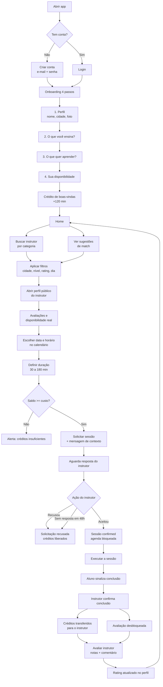
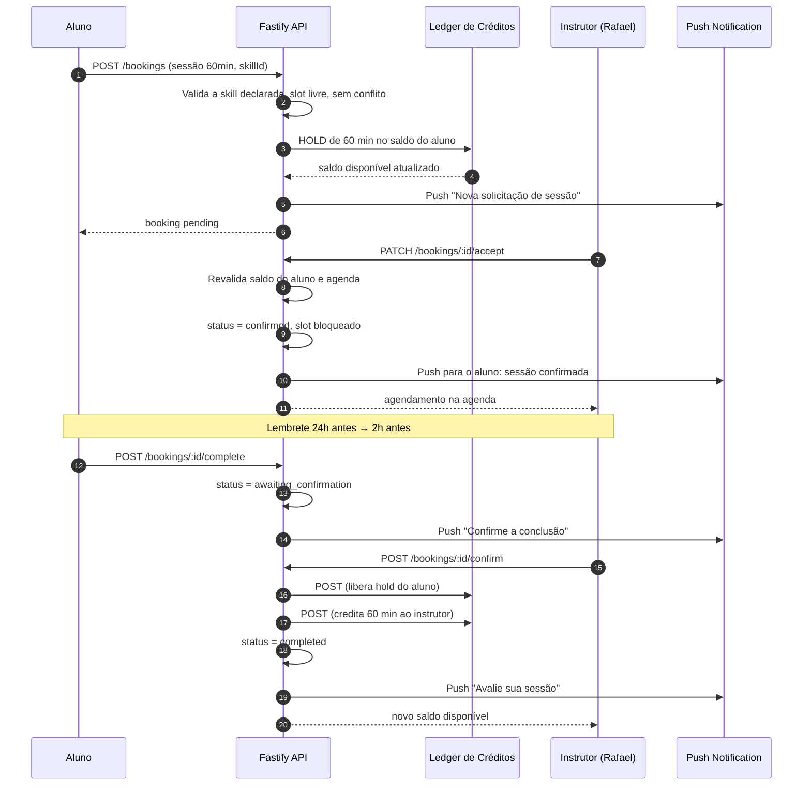
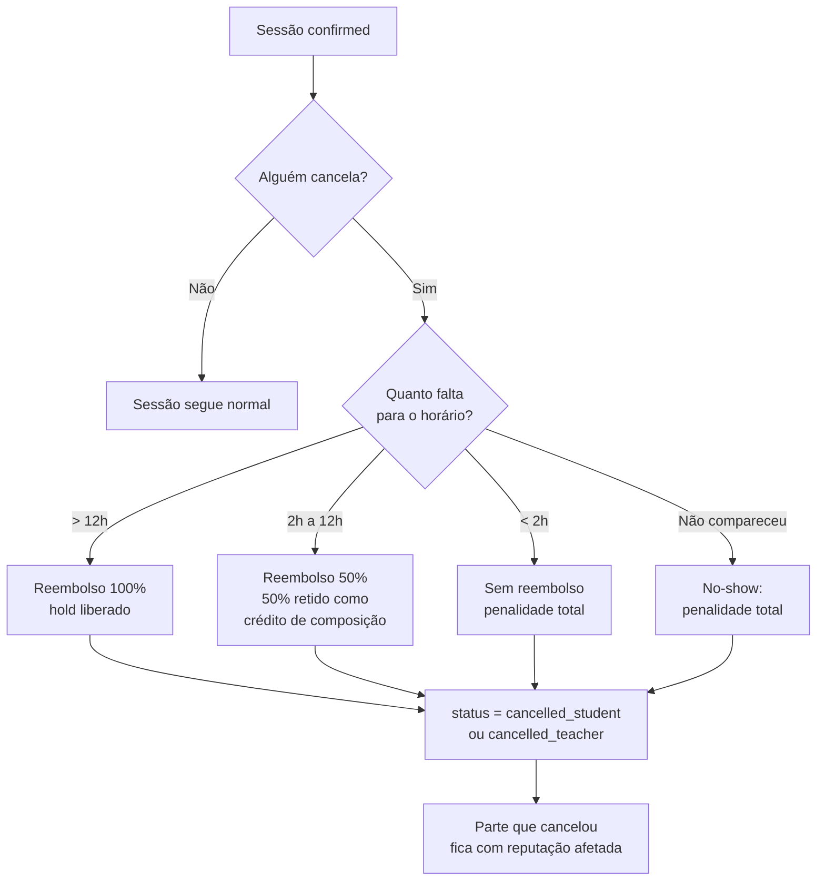

# PRD — HoraUtil

**Rede Social de Banco de Horas para troca de habilidades**

| Campo | Valor |
| --- | --- |
| Documento | Product Requirements Document (PRD) v1.1 — MVP |
| Produto | HoraUtil |
| Status | Aprovado para implementação |
| Stack | Kotlin (Android Nativo) · Jetpack Compose · Retrofit · Fastify (Node.js) · TypeScript · PostgreSQL + Drizzle ORM |
| Time | 5 desenvolvedores |
| Duração estimada do MVP | 8 semanas (4 sprints de 2 semanas) |
| Última atualização | 2026-10-02 |

---

## Sumário

1. [Visão Geral e Objetivos](#1-visão-geral-e-objetivos)
2. [Personas e Casos de Uso](#2-personas-e-casos-de-uso)
3. [Escopo e Funcionalidades Core](#3-escopo-e-funcionalidades-core)
4. [User Flow Principal](#4-user-flow-principal)
5. [Regras de Negócio](#5-regras-de-negócio)
6. [Requisitos Não Funcionais](#6-requisitos-não-funcionais)
7. [Estrutura de Dados Básica](#7-estrutura-de-dados-básica)
8. [Arquitetura e Contratos de API](#8-arquitetura-e-contratos-de-api)
9. [Métricas de Sucesso](#9-métricas-de-sucesso)
10. [Roadmap e Planejamento de Sprints](#10-roadmap-e-planejamento-de-sprints)
11. [Riscos e Mitigações](#11-riscos-e-mitigações)
12. [Anexos](#12-anexos)

---

## 1. Visão Geral e Objetivos

### 1.1 Resumo Executivo

O **HoraUtil** é uma rede social comunitária baseada em **créditos de tempo**. O usuário ganha direito ao consumo de horas de mentoria ao **ensinar** algo que domina e ao **confirmar a conclusão** de aulas que recebe. Não há dinheiro envolvido: a moeda é o tempo.

O diferencial do produto não é o agendamento em si, mas o **modelo de confiança e de reciprocidade** que se constrói ao redor dele:

> *"Ensinar é ganhar. Aprender é investir."*

### 1.2 Problema

| Dificuldade atual | Consequência para o usuário |
| --- | --- |
| Trocar habilidades (violão ↔ inglês ↔ programação ↔ culinária) depende de grupos locais e redes informais | Baixa descoberta de pessoas disponíveis |
| Aulas particulares tradicionais exigem dinheiro | Barreira de entrada para estudantes sem renda extra |
| Não existe reputação verificável de instrutor | Insegurança e assimetria de qualidade |
| Não há incentive para o profissional hobbyista ensinar sem retorno financeiro | O lado da oferta é ralo |

### 1.3 Proposta de Valor

| Para o **aluno** | Para o **instrutor** |
| --- | --- |
| Acesso a mentoria sem custo financeiro imediato | Monetização indireta do tempo: acumula créditos ao ensinar |
| Escolha por competência declarada e reputação | Visibilidade e status social (rating, número de alunos) |
| Trilha de aprendizado estruturada | Rede de contatos com habilidades complementares |
| Flexibilidade total: agenda organizada pelo próprio usuário | Constância de uso via obrigação social de manter a disponibilidade |

### 1.4 Objetivos do Produto (MVP)

| # | Objetivo | Métrica de sucesso |
| --- | --- | --- |
| O1 | Permitir que um usuário complete o onboarding e publique suas habilidades em **< 5 minutos** | Taxa de conclusão de onboarding ≥ 80% |
| O2 | Permitir que um aluno encontre um instrutor compatível e conclua o primeiro agendamento em **< 24 h** | Tempo mediano até 1º agendamento ≤ 48 h |
| O3 | Garantir integridade transacional do saldo de créditos (nunca negativo, nunca duplicado) | 0 incidentes de saldo inconsistente |
| O4 | Gerar avaliações úteis para decisão de match | ≥ 50% dos instrutores com ≥ 1 avaliação após 5 aulas |
| O5 | Entregar as 5 frentes do MVP sem dependências bloqueantes entre devs | 100% das epics concluídas no MVP |

### 1.5 Fora do Escopo do MVP (v2+)

- Pagamento em dinheiro / Taking Rate / assinatura premium
- Mensageria por chat em tempo real (v2 — no MVP, o contato é pelos campos de perfil)
- Videochamada embarcada (v2 — no MVP, o app sugere o app/meeting externo do usuário)
- Matching por geolocalização com raio em km (v2 — no MVP, cidade é apenas um filtro)
- Histórico público de timeline social / feed de atividades
- Moderação automatizada de conteúdo por IA
- Aplicativo web (dashboard administrativo) — apenas uma aba interna de suporte

---

## 2. Personas e Casos de Uso

### 2.1 Personas Primárias

#### Persona A — Marina, 23, Estudante de Design

| Atributo | Descrição |
| --- | --- |
| **Contexto** | Estudante universitária, mora sozinha, orçamento mensal apertado |
| **Habilidade que ensina** | Photoshop / Design (nível avançado — trabalha como freela aos fins de semana) |
| **Habilidade que quer aprender** | Violão intermediário e teoria musical básica |
| **Motivação** | Trocar conhecimento sem gastar dinheiro e fazer STATUS na faculdade |
| **Frustração atual** | Não conhece ninguém perto que troque design por música |
| **Comportamento no app** | 2 sessões de 60 min por mês, busca por cidade, avalia sempre os instrutores |
| **Citação** | *"Eu tenho uma hora de Photoshop que vale muito pra alguém. Quero trocar por aula de violão."* |

#### Persona B — Rafael, 31, Analista de Sistemas

| Atributo | Descrição |
| --- | --- |
| **Contexto** | CLT, quer.assertionar uma transição de carreira para back-end |
| **Habilidade que ensina** | Node.js / TypeScript (nível avançado) |
| **Habilidade que quer aprender** | Culinária saudável, inglês básico |
| **Motivação** | Payback direto: cada hora de mentoria conquistada financia horas de aula |
| **Frustração atual** | Mentoria gratuita no Stack Overflow não oferece acompanhamento contínuo |
| **Comportamento no app** | Alta disponibilidade, agenda aos sábados, é-fixado no topo da busca de Programação |
| **Citação** | *"Ensinar é a melhor forma de consolidar o que eu já sei."* |

#### Persona C — Júlia, 39, Mãe e empreendedora

| Atributo | Descrição |
| --- | --- |
| **Contexto** | Empreendedora, usa o celular em blocos curtos |
| **Habilidade que ensina** | Costura, crochê e Photoshop básico para pequenos negócios |
| **Habilidade que quer aprender** | Marketing digital, gestão financeira |
| **Motivação** | Rede de apoio, troca com outras mães empreendedoras |
| **Frustração atual** | Cursos online são caros e não combinam com a agenda dela |
| **Comportamento no app** | Prefere sessões curtas (30–60 min), usa bastante filtro de disponibilidade noturna |
| **Citação** | *"Se não posso sair do meu horário, quero aprender em qualquer horário que caiba."* |

### 2.2 Casos de Uso Principais

| ID | Caso de Uso | Ator Principal | Fluxo Resumido | Épico |
| --- | --- | --- | --- | --- |
| UC-01 | Criar conta e tornar-se "ensinável" | Marina | Cadastro → onboarding → declarar habilidades → definir disponibilidade | E1 |
| UC-02 | Encontrar alguém que ensine o que eu quero aprender | Marina | Busca por categoria → filtros → ver perfil → solicitar sessão | E2 |
| UC-03 | Aceitar ou recusar um pedido de sessão | Rafael | Notificação → conferir saldo/disponibilidade → aceitar | E3 |
| UC-04 | Confirmar a conclusão da aula e liberar créditos | Marina | Sair da sessão → marcar "aula concluída" → confirmação bilateral → saldo atualizado | E4 |
| UC-05 | Cancelar uma sessão e reagir a penalidade | Rafael | Cancelar → regra de janela → estorno/parcial | E3 + E4 |
| UC-06 | Avaliar o instrutor após a aula | Marina | Concluir → nota + comentário → rating público no perfil | E5 |
| UC-07 | Monitorar meu saldo de horas | Todos | Carteira → extrato de transações | E4 |
| UC-08 | Receber sugestão inteligente de match | Marina | Home → "Match com base no seu interesse mútuo" | E2 |

### 2.3 Job Stories (Definition of User Value)

| ID | História | Critério de aceite |
| --- | --- | --- |
| JS-01 | *Como aluno, quero declarar o que quero aprender para receber sugestões de instrutores relevantes.* | Aluno vê sugestões com ≥ 60% de compatibilidade de interesse mútuo |
| JS-02 | *Como instrutor, quero controlar minha disponibilidade para não receber pedidos que não posso cumprir.* | Slots bloqueados aparecem indisponíveis na busca |
| JS-03 | *Como aluno, quero ver o rating e a quantidade de aulas do instrutor antes de agendar.* | Perfil mostra média, total de aulas e avaliações |
| JS-04 | *Como instrutor, quero que o aluno confirme a conclusão para eu receber meus créditos.* | Crédito só entra após confirmação bilateral |
| JS-05 | *Como aluno, quero saber exatamente quanto vou gastar e ganhar em cada ação.* | Extrato mostra saldo anterior, delta e saldo posterior |

---

## 3. Escopo e Funcionalidades Core

### 3.1 Visão das Épicas (Épico → Dev → Módulos)

| Épico | Dev | Domínio | Entregável Principal |
| --- | --- | --- | --- |
| **E1 — Autenticação e Perfil** | Dev 1 | `auth`, `profile`, `users`, `skills` | Usuário capaz de se cadastrar, autenticar, completar onboarding e visível para busca |
| **E2 — Busca & Match** | Dev 2 | `search`, `matching` | Usuário encontra instrutores compatíveis e consegue abrir o perfil detalhado |
| **E3 — Agendamento** | Dev 3 | `availability`, `bookings`, `calendar` | Dois usuários agendam uma sessão em data/hora válida sem conflito |
| **E4 — Carteira/Créditos** | Dev 4 | `wallet`, `ledger`, `expiry` | Saldo exato, transação atômica e confirmação de aula transferindo créditos |
| **E5 — Avaliações & Reviews** | Dev 5 | `reviews`, `ratings` | Aluno avalia instrutor pós-aula e o rating alimenta perfil e busca |

### 3.2 Detalhamento por Responsabilidade

---

#### Dev 1 — Autenticação e Perfil

| # | Funcionalidade | Descrição | Telas (Compose) | Endpoints (Fastify) | Tabelas |
| --- | --- | --- | --- | --- | --- |
| F1.1 | Cadastro | E-mail + senha + nome. Regras de senha forte, e-mail único | `SignUp` | `POST /auth/register` | `users` |
| F1.2 | Login | E-mail + senha com JWT de acesso + refresh | `Login` | `POST /auth/login`, `POST /auth/refresh`, `POST /auth/logout` | `users`, `refresh_tokens` |
| F1.3 | Recuperação de senha | Envio de e-mail com token de reset (expiração 30 min) | `ForgotPassword`, `ResetPassword` | `POST /auth/forgot-password`, `POST /auth/reset-password` | `users`, `password_reset_tokens` |
| F1.4 | Revogação de sessões | "Sair de todos os dispositivos" | `Settings` | `POST /auth/logout-all` | `refresh_tokens` |
| F1.5 | Onboarding (wizard 4 passos) | Nome, cidade, foto, categorias que ensina, categorias que quer aprender, disponibilidade | `Onboarding` (4 steps) | `PATCH /me/onboarding` | `users`, `user_skills` |
| F1.6 | Perfil público | Bio, cidade, fuso, avatar, habilidades declaradas, rating médio, botão "Solicitar sessão" | `Profile`, `PublicProfile` | `GET /users/:id`, `PATCH /me` | `users`, `user_skills` |
| F1.7 | Declaração de habilidades — **Ensino** | CRUD de `teaches`: categoria + nível (Básico/Intermediário/Avançado) + descrição | `TeachingSkills` | `POST/GET/DELETE /me/teaches` | `user_skills` (`mode='teach'`) |
| F1.8 | Declaring habilidades — **Quero aprender** | CRUD de `wantsToLearn`: categoria + prioridade (Alta/Média/Baixa) | `LearningGoals` | `POST/GET/DELETE /me/learns` | `user_skills` (`mode='learn'`) |
| F1.9 | Disponibilidade | Grade semanal recorrente (dias + janelas de horário) | `AvailabilityEditor` | `GET/PUT /me/availability` | `availability_slots` |
| F1.10 | Exclusão de conta | Soft delete + anonimização em 30 dias (conforme LGPD) | `Settings` | `DELETE /me` | `users` |

**Contratos com os demais devs**

- **Dev 2** consome `GET /users/:id` e `GET /categories` para montar o card de resultado de busca.
- **Dev 3** consome `GET /me/availability` para bloquear slots.
- Contrato de dado fixado: `users.onboarding_completed_at IS NOT NULL` define "usuário ativo" para o matching.

---

#### Dev 2 — Busca & Match

| # | Funcionalidade | Descrição | Telas (Compose) | Endpoints (Fastify) | Tabelas |
| --- | --- | --- | --- | --- | --- |
| F2.1 | Catálogo de categorias | Árvore de categorias de habilidade (ex.: Música → Violão; Tecnologia → Programação → Node.js) | `CategoryPicker` | `GET /categories` | `categories` |
| F2.2 | Busca por categoria | Usuário escolhe "quero aprender: Violão" e vê quem ensina isso | `Search` | `GET /search/teachers?skillId=&city=` | `user_skills`, `users`, `reviews` |
| F2.3 | Filtros combináveis | Cidade, nível mínimo do instrutor, rating mínimo, disponibilidade (dia da semana/período), somente verificados | `SearchFilters` (bottom sheet) | mesmo endpoint, via query params | `availability_slots`, `reviews` |
| F2.4 | Ordenação e ranqueamento | Score relevance: match de interesse + rating + disponibilidade + recência + distância (v2) | `Search` | via query param `sort=` | — |
| F2.5 | Sugestões inteligentes | Recomenda perfis com **interesse mútuo** (eu ensino X ≈ ele quer aprender X e vice-versa) | `Home` (carrossel), `Matches` | `GET /me/matches`, `GET /me/suggestions` | `user_skills` |
| F2.6 | Card de resultado | Avatar, nome, cidade, "ensina: Violão · Avançado", rating, nº de aulas | `TeacherCard` | — | — |
| F2.7 | Bloqueio e denúncia | Reportar perfil/abuso (fluxo simples com motivo) | `ReportProfile` | `POST /reports` | `reports` |

**Algoritmo de score (v1, explicável e determinístico)**

```
score = 40% skillMatch
      + 20% rating (normalizado 0–5)
      + 15% mutualInterest
      + 15% availabilityOverlap
      + 10% activityRecency (última sessão em até 30 dias)
```

Todos os pesos ficam em configuração (`MATCHING_WEIGHTS`), permitindo tuning sem deploy.

---

#### Dev 3 — Módulo de Agendamento

| # | Funcionalidade | Descrição | Telas (Compose) | Endpoints (Fastify) | Tabelas |
| --- | --- | --- | --- | --- | --- |
| F3.1 | Calendário de disponibilidade | Exibição mensal/semanal com slots livres, ocupados e indisponíveis | `Calendar` | `GET /users/:id/availability/slots?from=&to=` | `availability_slots`, `bookings` |
| F3.2 | Solicitação de sessão | Aluno escolhe data, hora, duração e envia mensagem de contexto | `BookingRequest` | `POST /bookings` | `bookings` |
| F3.3 | Aceitar / recusar | Instrutor aceita (vira `confirmed`) ou recusa com motivo | `BookingInbox`, `BookingDetail` | `PATCH /bookings/:id/accept`, `PATCH /bookings/:id/decline` | `bookings` |
| F3.4 | Bloqueio de agenda | Sessão confirmada ocupa o slot; agenda pessoal do instrutor fica "ocupada" | `MyAgenda` | `GET /me/bookings?from=&to=` | `bookings` |
| F3.5 | Alteração (reschedule) | Reagendamento com revalidação de slot e regra de penalidade | `Reschedule` | `PATCH /bookings/:id/reschedule` | `bookings` |
| F3.6 | Cancelamento | Cancelar uma sessão por qualquer das partes com cálculo de penalidade | `CancelBooking` | `PATCH /bookings/:id/cancel` | `bookings` |
| F3.7 | Check-in e conclusão | Aluno sinaliza conclusão; instrutor confirma; sem ambos, expiração automática | `ActiveSession` | `POST /bookings/:id/complete`, `POST /bookings/:id/confirm` | `bookings` |
| F3.8 | Regras de conflito | Bloqueio transacional contra double-booking e sobreposição de slots | — | (validado no service) | `bookings`, `availability_slots` |
| F3.9 | Lembrete (push/email) | Lembrete 24 h e 2 h antes da sessão | — | `GET /me/upcoming` | `bookings`, `notifications` |

**Máquina de estados do agendamento**

```
pending ──accept──► confirmed ──complete(aluno)──► awaiting_confirmation ──confirm(instrutor)──► completed
   │                    │                                                        │
   ├──decline──► declined                     └──timeout 24h──► completed (automático) ──┘
   └──expira 48h──► declined (automático)
pending    ──cancel──► cancelled_student (reembolso integral)
confirmed  ──cancel c/ regra──► cancelled_student | cancelled_teacher (reembolso total, parcial ou sem reembolso)
confirmed  ──check-in timeout (30 min)──► no_show
```

> O enum `booking_status` não inclui um estado `cancelled` genérico: a distinção entre `cancelled_student` e `cancelled_teacher` é necessária para atribuir a penalidade e a reputação (BR-401 a BR-406).

**Duração e granularidade**

- Duração válida: **30, 60, 90, 120 ou 180 minutos**.
- Granularidade do calendário: **30 minutos**.
- Slots de disponibilidade devem ter início e fim alinhados à grade de 30 min.

---

#### Dev 4 — Sistema de Carteira/Créditos

| # | Funcionalidade | Descrição | Telas (Compose) | Endpoints (Fastify) | Tabelas |
| --- | --- | --- | --- | --- | --- |
| F4.1 | Crédito de boas-vindas | Saldo inicial ao concluir onboarding | — (automático) | `POST /wallet/welcome-credit` | `wallet_entries` |
| F4.2 | Saldo atual | Saldo disponível em minutos, calculado a partir do ledger | `WalletCard` (Home) | `GET /me/wallet` | `wallet_entries` |
| F4.3 | Reserva de crédito (hold) | Ao solicitar sessão, o valor é **reservado** e não pode ser gasto em dobro | `BookingRequest` | `POST /bookings` (interno) | `wallet_entries` (`status='held'`) |
| F4.4 | Confirmação / liberação | Conclusão libera o hold e credita o instrutor | `ActiveSession` | `POST /bookings/:id/confirm` | `wallet_entries` |
| F4.5 | Estorno e penalidade | Cancelamento devolve total/parcial ou não devolve conforme a janela | `CancelBooking` | `PATCH /bookings/:id/cancel` | `wallet_entries` |
| F4.6 | Extrato de transações | Lista paginada de entradas/saídas com saldo anterior e posterior | `TransactionHistory` | `GET /me/wallet/entries` | `wallet_entries` |
| F4.7 | Expiração de créditos | Créditos mais antigos expiram primeiro (FIFO) após a carência | — (job diário) | `POST /internal/jobs/expire-credits` | `wallet_entries` |
| F4.8 | Transferência de presente (v2) | Presentear créditos a outro usuário | — | — | — |

**Modelo contábil (ledger imutável)**

O saldo **nunca** é um campo mutável em `users`. Ele é sempre derivado:

```
saldo_disponível(u) = Σ(wallet_entries WHERE user_id = u AND status = 'posted')   -- minutos
                     − Σ(wallet_entries WHERE user_id = u AND status = 'held')
saldo_total(u)      = Σ(wallet_entries WHERE user_id = u AND status IN ('posted','held'))
```

Todo lançamento é append-only e carrega `balance_after` para auditoria. Correções são feitas por **estorno** (novo lançamento), nunca por `UPDATE`.

---

#### Dev 5 — Avaliações & Reviews

| # | Funcionalidade | Descrição | Telas (Compose) | Endpoints (Fastify) | Tabelas |
| --- | --- | --- | --- | --- | --- |
| F5.1 | Formulário pós-aula | Modal com nota (1–5 estrelas) + comentário textual (10–500 chars) | `RateSession` | `POST /bookings/:id/review` | `reviews` |
| F5.2 | Regra de elegibilidade | Só quem participou da sessão `completed` pode avaliar, 1 vez por sessão, em até 7 dias | — | (server-side) | `reviews`, `bookings` |
| F5.3 | Média agregada no perfil | Média ponderada por recência (médias antigas pesam menos) | `PublicProfile` | `GET /users/:id` | `reviews` |
| F5.4 | Listagem de reviews | Feed de avaliações do perfil, paginado, com nome do avaliador (parcial) | `ProfileReviews` | `GET /users/:id/reviews` | `reviews` |
| F5.5 | Resposta do instrutor | Instrutor pode responder publicamente a uma review (1 por review) | `ReviewDetail` | `POST /reviews/:id/reply` | `reviews` |
| F5.6 | Sinalização de review | Denunciar review abusiva/inverossímil | `ReviewDetail` | `POST /reviews/:id/report` | `reviews`, `reports` |
| F5.7 | Badge de instrutor confiável | Selo automático para instrutores com ≥ 5 aulas e rating ≥ 4,5 | `PublicProfile` | (derivado) | `reviews`, `bookings` |

**Distribuição de notas (histórico)**

| Nota | Rótulo | Efeito no produto |
| --- | --- | --- |
| 5 | Excelente | Peso alto no match (E2) |
| 4 | Muito bom | Peso alto |
| 3 | Regular | Peso neutro |
| 2 | Ruim | Instrutor perde visibilidade no match |
| 1 | Péssimo | Instrutor perde visibilidade + sinalização para moderação |

---

### 3.3 Matriz de Dependências e Ordem de Execução

| Consumi\Fornece | Dev 1 (Auth/Perfil) | Dev 2 (Busca) | Dev 3 (Agenda) | Dev 4 (Carteira) | Dev 5 (Reviews) |
| --- | --- | --- | --- | --- | --- |
| **Dev 1** | — | `users`, `categories`, `user_skills` | `users`, `skills` | `users`, `wallet_entries` | `users` |
| **Dev 2** | consome | — | consome `availability_slots` | consome saldo p/ filtro | consome rating p/ score |
| **Dev 3** | consome | consome perfil p/ sessão | — | consome saldo p/ validação | consome elegibilidade |
| **Dev 4** | consome | consome saldo p/ filtro | consome booking p/ evento | — | consome conclusão p/ gatilho |
| **Dev 5** | consome | consome rating p/ score | consome booking concluída | consome saldo p/ status | — |

> **Contrato de integração obrigatória (Sprint 0–1):** Dev 1 é o **owner do schema de `users`, `categories`, `user_skills` e `availability_slots`**. Os demais devs consomem essas tabelas via Drizzle schema compartilhado (monorepo), sem criar duplicatas. Mudanças de contrato passam por PR único contra `packages/db`.

---

## 4. User Flow Principal

### 4.1 Visão de Fluxo (Aluno)



### 4.2 Visão de Fluxo (Instrutor — recebe a sessão)



### 4.3 Fluxo de Cancelamento (ramificação crítica)



### 4.4 Estados da UX por Tela (Happy Path Checklist)

| # | Tela | Estado Inicial | Estados de Erro Obrigatórios | Loading |
| --- | --- | --- | --- | --- |
| 1 | Login | Formulário | `401 credenciais inválidas`, `429 muitas tentativas` | Botão em spinner |
| 2 | Onboarding | Step 1/4 | `validação de campo`, `falha de rede com retry` | Skeleton de progresso |
| 3 | Home | Sugestões + busca | `sem matches → state vazio com CTA "amplie a busca"` | Shimmer de cards |
| 4 | Busca | Lista de instrutores | `nenhum resultado`, `perda de conexão` | infinite scroll |
| 5 | Perfil público | Dados do instrutor | `perfil indisponível`, `não posso agendar (sem saldo)` | — |
| 6 | Calendário | Slots do instrutor | `todos os slots ocupados`, `fora da disponibilidade` | Grid skeleton |
| 7 | Solicitar sessão | Resumo da sessão | `saldo insuficiente`, `slot acabou de ser tomado (409)` | Botão desabilitado |
| 8 | Aguardando resposta | Timer de expiração | `instrutor recusou`, `expirou` | — |
| 9 | Sessão ativa | Check-in e conclusão | `check-in ainda não liberado`, `já confirmada` | — |
| 10 | Avaliar | Formulário 1–5 | `fora do prazo`, `já avaliada`, `mínimo de 10 caracteres` | — |
| 11 | Carteira | Saldo + extrato | `saldo negativo (estado inesperado)` | Skeleton de saldo |

---

## 5. Regras de Negócio

### 5.1 Conta e Onboarding

| ID | Regra | Valor / Comportamento |
| --- | --- | --- |
| BR-001 | E-mail único | Case-insensitive, normalizado para minúsculas |
| BR-002 | Senha forte | Mínimo 8 caracteres, com 1 letra + 1 número; PBKDF2/argon2id |
| BR-003 | Onboarding obrigatório | `users.onboarding_completed_at` é preenchido apenas ao concluir os 4 passos |
| BR-004 | Mínimo para ser encontrado | Ter ≥ 1 habilidade em `mode='teach'` e disponibilidade configurada |
| BR-005 | Username público | **Fora do escopo do MVP** — login apenas por e-mail |
| BR-006 | Idade mínima | 16 anos (termo de uso no cadastro) |
| BR-007 | Exclusão de conta | Soft delete; anonimização (PII) após 30 dias; lançamentos contábeis preservados para auditoria |

### 5.2 Créditos e Saldo

| ID | Regra | Valor / Comportamento |
| --- | --- | --- |
| BR-101 | **Saldo inicial (bônus de boas-vindas)** | **+120 min (2 horas)** creditados **uma única vez**, no momento em que o onboarding é concluído |
| BR-102 | Limite de crédito por aula | O instrutor pode ganhar no máximo `session_minutes` por sessão concluída (sem markup) |
| BR-103 | Reserva (hold) na solicitação | O valor da sessão é reservado imediatamente; não pode ser gasto em duas solicitações simultâneas |
| BR-104 | Transferência só na conclusão | Créditos do instrutor entram **apenas** quando `status = COMPLETED` (confirmação bilateral) |
| BR-105 | Validade do crédito | Cada crédito expira em **90 dias corridos** contados da sua entrada. Consumo é **FIFO** (o mais antigo primeiro) |
| BR-106 | Carência de expiração | Créditos que sobrarem do bônus e ficarem sem uso por 45 dias também caem — sem penalidade de reputação |
| BR-107 | Nunca negativo | Uma transação só é efetivada se `saldo_disponível >= valor`. Falha retorna `422 INSUFFICIENT_CREDITS` |
| BR-108 | Integridade transacional | Todas as movimentações em transação SQL única com `SELECT ... FOR UPDATE` no ledger do usuário |
| BR-109 | Estorno é append-only | Correções geram novo lançamento do tipo `reversal`, nunca alteração de lançamento anterior |
| BR-110 | Sem dinheiro | Não existe pagamento, saque ou conversão de créditos para dinheiro no produto |

### 5.3 Habilidades e Níveis

| ID | Regra | Valor / Comportamento |
| --- | --- | --- |
| BR-201 | Catálogo fechado | Usuário escolhe apenas categorias existentes em `categories` (não cria categoria livre) |
| BR-202 | Níveis | `beginner`, `intermediate`, `advanced` — obrigatórios para `mode='teach'`, opcionais para `mode='learn'` |
| BR-203 | Limite de habilidades | Máx. **10** habilidades que ensina e **10** habilidades que quer aprender |
| BR-204 | Coerência do match | Sugestões só são oferecidas quando existe interesse mútuo real (ensina ↔ quer aprender) |
| BR-205 | Cache de categorias | Categorias são cacheadas no app (30 dias) — baixa latência no seletor |

### 5.4 Agendamento

| ID | Regra | Valor / Comportamento |
| --- | --- | --- |
| BR-301 | Duração | Múltiplos de 30 min, entre **30** e **180 min** |
| BR-302 | Antecedência mínima | Sessão deve ser agendada com no mínimo **2 h** de antecedência |
| BR-303 | Horizonte de agendamento | Até **90 dias** à frente |
| BR-304 | Janela de aceitação | Solicitação `pending` expira em **48 h** e é liberada automaticamente |
| BR-305 | Dentro da disponibilidade | O slot deve estar dentro de um `availability_slot` ativo do instrutor |
| BR-306 | Sem conflito | Não é possível aceitar uma sessão que sobreponha outra `confirmed` do mesmo instrutor (garantido com `EXCLUDE USING gist` no Postgres) |
| BR-307 | Reagendamento | Só com a sessão já confirmada, e segue a mesma regra de antecedência. Não gera penalidade se ≥ 12 h antes |
| BR-308 | Check-in | O aluno inicia o check-in no horário; o instrutor tem **30 min de tolerância** antes de ser marcado como `no_show` |
| BR-309 | Conclusão automática | Se o aluno marcar conclusão e o instrutor não responder em **24 h**, o sistema confirma automaticamente |
| BR-310 | Idempotência | `complete` e `confirm` são idempotentes — chamadas repetidas retornam `200` sem duplicar crédito |

### 5.5 Política de Cancelamento

| Momento do cancelamento | Consequência para quem cancela | Alvo do crédito | Consequência reputacional |
| --- | --- | --- | --- |
| **> 12 h** antes | Reembolso integral | Instrutor | Nenhuma |
| **Entre 2 h e 12 h** antes | Reembolso de 50% | Instrutor (50%) | Contador de cancelamentos++ |
| **< 2 h** antes | Sem reembolso | Instrutor (100%) | Contador de cancelamentos++ + badge de "agenda frágil" |
| **Não comparecimento (no-show)** | Sem reembolso | Instrutor (100%) | Marcado como no-show no perfil |

**Regras adicionais da política**

| ID | Regra |
| --- | --- |
| BR-401 | Cancelamento é sempre permitido; a regra define apenas a **consequência financeira**, nunca bloqueia o usuário |
| BR-402 | Cancelamento por **força maior** (ex.: doença reportada com documento) é reembolsado em 100% e definido manualmente pelo suporte |
| BR-403 | **3 cancelamentos (< 12 h) em 90 dias** resultam em suspensão temporária de 14 dias para solicitar novas sessões |
| BR-404 | **2 no-shows** resultam em bloqueio permanente de agendamento |
| BR-405 | Alunos com saldo zerado **não podem** solicitar novas sessões, mas continuam visíveis na busca |
| BR-406 | Instrutores com saldo zerado **não podem** agendar aulas (para garantir que a cobrança do aluno não falhe) |

### 5.6 Avaliações

| ID | Regra | Valor / Comportamento |
| --- | --- | --- |
| BR-501 | Elegibilidade | Somente participantes de uma sessão `completed` |
| BR-502 | Unicidade | Máx. 1 review por sessão |
| BR-503 | Prazo | Até **7 dias** após a conclusão |
| BR-504 | Nota obrigatória | 1–5 estrelas; comentário com 10–500 caracteres |
| BR-505 | Editável | Sim, em até 24 h após o envio |
| BR-506 | Peso da média | Média ponderada por recência — `peso = 1 / (1 + meses/6)` — evitando notas de 2019 dominando o perfil |
| BR-507 | Anonimato do avaliador | Nome do avaliador exibido parcialmente (`Marina S.`) |
| BR-508 | Uso do rating no match | Notas < 3 reduzem a visibilidade do perfil em até 60% no ranqueamento de busca |

### 5.7 Segurança e Fraude (Regras de Backend)

| ID | Regra |
| --- | --- |
| BR-701 | Todas as operações de escrita validam `user_id` do JWT — **nunca** aceitam `user_id` do body |
| BR-702 | Qualquer cliente pode ler apenas dados públicos de perfil; e-mail e telefone **nunca** são expostos |
| BR-703 | Rate limiting: 100 req/min na API de leitura, 10 req/min em autenticação |
| BR-704 | Bloqueio de conta: se a detecção de 3+ avaliações suspeitas em 24 h, o perfil entra em revisão manual |
| BR-705 | Todas as operações de ledger geram log de auditoria (`audit_log`) com ator, IP e payload |
| BR-706 | Um usuário só pode avaliar e agendar com usuários **não bloqueados** por ele |

---

## 6. Requisitos Não Funcionais

### 6.1 Performance

| ID | Requisito | Métrica |
| --- | --- | --- |
| NF-P01 | Tempo de resposta da API (leitura) | **p95 < 300 ms**, p99 < 800 ms |
| NF-P02 | Tempo de resposta da API (escrita) | p95 < 500 ms |
| NF-P03 | App cold start (Android) | < 2,5 s em dispositivos mid-range |
| NF-P04 | Tempo de primeira renderização das telas (Compose) | < 2,5 s em 4G |
| NF-P05 | Tempo de resposta da busca | p95 < 400 ms com até 100 mil perfis indexados |
| NF-P06 | Paginação | Todas as listagens usam **cursor pagination** (nunca `OFFSET`) |
| NF-P07 | Tamanho do bundle | APK < 60 MB |
| NF-P08 | Uploads de imagem | Compressão client-side para no máximo 1080 px e 85% de qualidade |

### 6.2 Segurança

| ID | Requisito | Detalhamento |
| --- | --- | --- |
| NF-S01 | **Autenticação JWT** | **Access token**: JWT HS256/RS256, expiração **15 min**, stateless. **Refresh token**: opaco, aleatório (128 bits), expiração **30 dias**, rotação a cada uso, armazenado **hashado (SHA-256)** no banco |
| NF-S02 | Armazenamento de senha | argon2id (ou bcrypt cost ≥ 12) — nunca texto plano ou reversível |
| NF-S03 | Transporte | TLS 1.3 obrigatório; HSTS habilitado; **nenhuma** chamada a API em HTTP |
| NF-S04 | Injeção de SQL | Drizzle ORM com parâmetros preparados — concatenação de SQL proibida |
| NF-S05 | Validação de entrada | **Zod** em todas as rotas; payload máximo de 1 MB |
| NF-S06 | Rate limiting | `@fastify/rate-limit` — 100 req/min geral; 10 req/min em `/auth/*` |
| NF-S07 | Headers de segurança | `@fastify/helmet` com CSP restritiva |
| NF-S08 | CORS | Allowlist explícita de domínios e apps registrados |
| NF-S09 | Segredos | Somente variáveis de ambiente / secret manager; **zero** segredos no repositório |
| NF-S10 | Autorização | Checagem de ownership em toda rota de recurso (`user_id` do token vs. recurso) |
| NF-S11 | Tokens de reset | Expiração de 30 min, uso único, armazenado hasheado |
| NF-S12 | LGPD | Consentimento explícito no onboarding; exportação de dados (`GET /me/export`); eliminação em 30 dias |
| NF-S13 | Refresh token no cliente | `Secure` + `HttpOnly` + `SameSite=Strict`; access token apenas em memória |

### 6.3 Escalabilidade e Arquitetura

| ID | Requisito |
| --- | --- |
| NF-E01 | Arquitetura modular por domínio (`auth`, `profile`, `search`, `booking`, `wallet`, `review`) |
| NF-E02 | Monorepo com pacotes compartilhados: `apps/api`, `apps/mobile`, `packages/db`, `packages/ui`, `packages/contracts` |
| NF-E03 | Módulos HTTP registrados com prefixo de versão (`/v1`) |
| NF-E04 | Jobs agendados (expiração de crédito, expiração de `pending`, auto-complete) via worker do backend |
| NF-E05 | Índice `(user_id, status)` em `bookings`; índice GIN em `user_skills`; índice full-text em `categories` |
| NF-E06 | Suporte a **100 mil usuários** e **10 mil sessões/mês** sem degradação de latência |
| NF-E07 | Estratégia de cache: `Redis` (opcional no MVP) para rate limit e sessões de match |
| NF-E08 | Deploy em container; migrações Drizzle versionadas (`drizzle-kit generate` + `migrate`) |

### 6.4 Observabilidade

| ID | Requisito |
| --- | --- |
| NF-O01 | Logs estruturados com **Pino** + request-id |
| NF-O02 | Rastreamento de erros com **Sentry** (mobile e API) |
| NF-O03 | Alertas: erro 5xx > 1% em 5 min; p95 > 500 ms por 10 min |
| NF-O04 | Métricas de negócio no ledger: transferências por dia, saldo médio, taxa de conclusão |
| NF-O05 | Correlation ID entre requisição mobile e log da API |

### 6.5 Qualidade e Testes

| ID | Requisito |
| --- | --- |
| NF-Q01 | Cobertura mínima de **80%** em `packages/db` e nos serviços de domínio (`wallet`, `booking`) |
| NF-Q02 | Testes unitários: **Vitest** (compartilhado entre API e pacotes) |
| NF-Q03 | Testes de integração de API: `supertest`/`inject` com Postgres de teste (Testcontainers) |
| NF-Q04 | Testes E2E dos fluxos críticos: cadastro → match → agendamento → conclusão → avaliação |
| NF-Q05 | Lint + typecheck obrigatórios no CI; **zero** erro de TypeScript na API e **ktlint/detekt** limpo no app Android em `main` |
| NF-Q06 | Conventional Commits + PR review obrigatório de 1 par para código de domínio (wallet, booking) |

### 6.6 Usabilidade e Acessibilidade

| ID | Requisito |
| --- | --- |
| NF-UX01 | Idioma **pt-BR** como único idioma do MVP |
| NF-UX02 | Suporte a **dark mode** seguindo configuração do sistema |
| NF-UX03 | Alvos de toque ≥ 48×48 dp (Material Design 3) |
| NF-UX04 | Contraste mínimo WCAG AA (4.5:1) em todos os textos |
| NF-UX05 | Telas de erro sempre com ação de recuperação ("Tentar novamente") |
| NF-UX06 | Estados vazios com ilustração + texto explicativo + CTA |

### 6.7 Offline e Resiliência

| ID | Requisito |
| --- | --- |
| NF-R01 | Cache local das categorias e do próprio perfil (via Room/DataStore no app Android) |
| NF-R02 | Fila de leitura offline: o usuário vê sua agenda e saldo em cache |
| NF-R03 | Retry exponencial (3 tentativas) em falhas de rede no cliente |
| NF-R04 | Degradação graciosa: sem conexão, mostrar "offline" e bloquear apenas ações de escrita |

---

## 7. Estrutura de Dados Básica

### 7.1 Diagrama de Entidades (simplificado)

```mermaid
erDiagram
    users ||--o{ user_skills : "declara"
    users ||--o{ availability_slots : "tem"
    users ||--o{ wallet_entries : "movimenta"
    users ||--o{ bookings : "ensina (teacher)"
    users ||--o{ bookings : "aprende (student)"
    users ||--o{ reviews : "escreve"
    users ||--o{ refresh_tokens : "possui"
    categories ||--o{ user_skills : "classifica"
    categories ||--o{ categories : "contém"
    bookings ||--o{ wallet_entries : "movimenta"
    bookings ||--o| reviews : "gera"
    reviews ||--o| reviews : "responde"

    users {
        uuid id PK
        varchar email UK
        varchar password_hash
        varchar name
        text bio
        varchar city
        varchar timezone
        timestamp onboarding_completed_at
        enum status
    }
    categories {
        uuid id PK
        varchar name
        varchar slug UK
        uuid parent_id FK
        varchar icon
    }
    user_skills {
        uuid id PK
        uuid user_id FK
        uuid category_id FK
        enum mode
        enum level
        text description
    }
    availability_slots {
        uuid id PK
        uuid user_id FK
        smallint weekday
        time start_time
        time end_time
        boolean active
    }
    bookings {
        uuid id PK
        uuid teacher_id FK
        uuid student_id FK
        uuid category_id FK
        timestamptz scheduled_at
        int duration_minutes
        int credits_amount
        enum status
        text student_message
        text cancellation_reason
        timestamptz completed_at
    }
    wallet_entries {
        uuid id PK
        uuid user_id FK
        uuid booking_id FK
        enum type
        int minutes
        enum status
        timestamptz expires_at
        int balance_after
        varchar description
    }
    reviews {
        uuid id PK
        uuid booking_id FK UK
        uuid reviewer_id FK
        uuid reviewee_id FK
        smallint rating
        text comment
        uuid reply_to_id FK
        timestamptz created_at
    }
```

### 7.2 Tabelas Principais — Detalhamento

#### `users`

| Coluna | Tipo | Constraints | Descrição |
| --- | --- | --- | --- |
| `id` | `uuid` | PK, default `gen_random_uuid()` | Identificador único |
| `email` | `varchar(255)` | UNIQUE, NOT NULL, lowercase | E-mail de acesso |
| `password_hash` | `varchar(255)` | NOT NULL | Hash argon2id |
| `name` | `varchar(120)` | NOT NULL | Nome exibido publicamente |
| `avatar_url` | `varchar(500)` | NULL | URL da foto |
| `bio` | `text` | NULL, máx. 500 chars | Descrição do perfil |
| `city` | `varchar(120)` | NULL | Cidade (filtro de busca) |
| `timezone` | `varchar(60)` | NOT NULL, default `'America/Sao_Paulo'` | Fuso para cálculo de agenda |
| `onboarding_completed_at` | `timestamptz` | NULL | Marca usuário ativo |
| `status` | `user_status` | NOT NULL, default `'active'` | `active` \| `suspended` \| `deleted` |
| `suspended_until` | `timestamptz` | NULL | Fim da suspensão (BR-403) |
| `no_show_count` | `smallint` | NOT NULL, default `0` | Contador de no-show (BR-404) |
| `rating_avg` | `numeric(3,2)` | NULL | Cache denormalizado do rating |
| `sessions_as_teacher` | `integer` | NOT NULL, default `0` | Cache para ordenação |
| `created_at` | `timestamptz` | NOT NULL, default `now()` | |
| `updated_at` | `timestamptz` | NOT NULL, default `now()` | |

**Índices:** `idx_users_email` (UNIQUE), `idx_users_city`, `idx_users_rating` (`rating_avg DESC`), `idx_users_onboarding` (`onboarding_completed_at IS NOT NULL`)

#### `categories`

| Coluna | Tipo | Constraints | Descrição |
| --- | --- | --- | --- |
| `id` | `uuid` | PK | |
| `name` | `varchar(100)` | NOT NULL | Ex.: "Violão" |
| `slug` | `varchar(100)` | UNIQUE, NOT NULL | Identificador URL |
| `parent_id` | `uuid` | FK → `categories.id`, NULL | Hierarquia (ex.: Música → Violão) |
| `icon` | `varchar(50)` | NULL | Ícone do app |
| `search_vector` | `tsvector` | GIN index | Busca full-text em pt-BR |

#### `user_skills`

| Coluna | Tipo | Constraints | Descrição |
| --- | --- | --- | --- |
| `id` | `uuid` | PK | |
| `user_id` | `uuid` | FK → `users.id` ON DELETE CASCADE | |
| `category_id` | `uuid` | FK → `categories.id` | |
| `mode` | `skill_mode` | NOT NULL | `teach` \| `learn` |
| `level` | `skill_level` | NULL | `beginner` \| `intermediate` \| `advanced` — obrigatório se `mode='teach'` |
| `priority` | `smallint` | NULL, default `3` | Prioridade de aprendizagem (1 = alta) |
| `description` | `text` | NULL, máx. 300 chars | Detalhe do que sabe/quer saber |

**Constraints:** `UNIQUE(user_id, category_id, mode)` · CHECK `mode='teach' → level IS NOT NULL` · Limite de 10 por mode (validado no service)

#### `availability_slots`

| Coluna | Tipo | Constraints | Descrição |
| --- | --- | --- | --- |
| `id` | `uuid` | PK | |
| `user_id` | `uuid` | FK → `users.id` ON DELETE CASCADE | |
| `weekday` | `smallint` | NOT NULL, 0–6 | 0 = domingo |
| `start_time` | `time` | NOT NULL | Alinhado a 30 min |
| `end_time` | `time` | NOT NULL | `end_time > start_time` |
| `active` | `boolean` | NOT NULL, default `true` | Permite desativar sem apagar histórico |

**Índice:** `idx_availability_user_weekday` (`user_id, weekday`)

#### `bookings`

| Coluna | Tipo | Constraints | Descrição |
| --- | --- | --- | --- |
| `id` | `uuid` | PK | |
| `teacher_id` | `uuid` | FK → `users.id` | Instrutor |
| `student_id` | `uuid` | FK → `users.id` | Aluno |
| `category_id` | `uuid` | FK → `categories.id` | Habilidade ensinada |
| `scheduled_at` | `timestamptz` | NOT NULL | Início da sessão (UTC) |
| `duration_minutes` | `smallint` | NOT NULL, 30–180, múltiplo de 30 | |
| `credits_amount` | `smallint` | NOT NULL | `= duration_minutes` (1h = 1 crédito) |
| `status` | `booking_status` | NOT NULL, default `'pending'` | `pending` \| `confirmed` \| `awaiting_confirmation` \| `completed` \| `declined` \| `cancelled_student` \| `cancelled_teacher` \| `no_show` |
| `student_message` | `text` | NULL, máx. 500 chars | Contexto enviado na solicitação |
| `meeting_type` | `varchar(20)` | NOT NULL, default `'external'` | `online` \| `in_person` \| `external` |
| `meeting_location` | `varchar(200)` | NULL | Link ou endereço (visível só entre as partes) |
| `cancelled_by` | `uuid` | FK → `users.id`, NULL | |
| `cancellation_reason` | `text` | NULL | |
| `cancelled_at` | `timestamptz` | NULL | |
| `student_completed_at` | `timestamptz` | NULL | Check-in/conclusão do aluno |
| `completed_at` | `timestamptz` | NULL | Conclusão bilateral |
| `created_at` | `timestamptz` | NOT NULL, default `now()` | |
| `updated_at` | `timestamptz` | NOT NULL, default `now()` | |

**Índices e constraints críticas**

```sql
-- Prevenir sobreposição de sessões confirmadas do mesmo instrutor
EXCLUDE USING gist (
  teacher_id WITH =,
  tstzrange(scheduled_at, scheduled_at + (duration_minutes || ' minutes')::interval) WITH &&
) WHERE (status IN ('confirmed', 'awaiting_confirmation'));

-- Performance das queries de agenda
CREATE INDEX idx_bookings_teacher_time ON bookings (teacher_id, scheduled_at) WHERE status IN ('confirmed', 'awaiting_confirmation');
CREATE INDEX idx_bookings_student_time ON bookings (student_id, scheduled_at) WHERE status IN ('confirmed', 'awaiting_confirmation');
CREATE INDEX idx_bookings_status_expiry ON bookings (status, created_at) WHERE status = 'pending';
```

#### `wallet_entries` (ledger imutável)

| Coluna | Tipo | Constraints | Descrição |
| --- | --- | --- | --- |
| `id` | `uuid` | PK | |
| `user_id` | `uuid` | FK → `users.id` | Dono do saldo |
| `booking_id` | `uuid` | FK → `bookings.id`, NULL | Origem da movimentação |
| `type` | `entry_type` | NOT NULL | `welcome_bonus` \| `session_earned` \| `session_spent` \| `refund` \| `penalty` \| `adjustment` \| `reversal` \| `expiry` |
| `minutes` | `integer` | NOT NULL, > 0 | Valor absoluto (sinal vem do `type`) |
| `status` | `entry_status` | NOT NULL, default `'posted'` | `held` \| `posted` \| `released` \| `expired` \| `reversed` |
| `expires_at` | `timestamptz` | NULL | Somente para créditos de origem externa |
| `balance_after` | `integer` | NOT NULL | Snapshot do saldo total após o lançamento (auditoria) |
| `description` | `varchar(200)` | NULL | Texto legível no extrato |
| `created_at` | `timestamptz` | NOT NULL, default `now()` | |

**View de saldo**

```sql
CREATE VIEW user_wallet_balance AS
SELECT
  u.id AS user_id,
  COALESCE(SUM(e.minutes) FILTER (WHERE e.status = 'posted'), 0)::integer AS total_minutes,
  COALESCE(SUM(e.minutes) FILTER (WHERE e.status = 'held'), 0)::integer   AS held_minutes,
  GREATEST(
    COALESCE(SUM(e.minutes) FILTER (WHERE e.status = 'posted'), 0)
    - COALESCE(SUM(e.minutes) FILTER (WHERE e.status = 'held'), 0),
    0
  )::integer AS available_minutes
FROM users u
LEFT JOIN wallet_entries e ON e.user_id = u.id
GROUP BY u.id;
```

#### `reviews`

| Coluna | Tipo | Constraints | Descrição |
| --- | --- | --- | --- |
| `id` | `uuid` | PK | |
| `booking_id` | `uuid` | FK → `bookings.id`, **UNIQUE** | Garante 1 review por sessão (BR-502) |
| `reviewer_id` | `uuid` | FK → `users.id` | Autor (aluno) |
| `reviewee_id` | `uuid` | FK → `users.id` | Avaliado (instrutor) |
| `rating` | `smallint` | NOT NULL, CHECK (1–5) | Nota |
| `comment` | `text` | NOT NULL, 10–500 chars | Texto |
| `reply_to_id` | `uuid` | FK → `reviews.id`, NULL | Resposta do instrutor |
| `reply_text` | `text` | NULL, máx. 300 chars | |
| `replied_at` | `timestamptz` | NULL | |
| `edited_at` | `timestamptz` | NULL | |
| `created_at` | `timestamptz` | NOT NULL, default `now()` | |

**Índices:** `idx_reviews_reviewee` (`reviewee_id, created_at DESC`) · `idx_reviews_rating` (`reviewee_id, rating`)

#### Tabelas de Apoio

| Tabela | Propósito | Colunas Principais |
| --- | --- | --- |
| `refresh_tokens` | Sessões ativas | `id`, `user_id`, `token_hash`, `expires_at`, `revoked_at`, `device_info`, `created_at` |
| `password_reset_tokens` | Recuperação de senha | `id`, `user_id`, `token_hash`, `expires_at`, `used_at` |
| `notifications` | Feed de notificações | `id`, `user_id`, `type`, `title`, `body`, `data` (JSONB), `read_at`, `created_at` |
| `user_blocks` | Bloqueio entre usuários | `id`, `blocker_id`, `blocked_id`, `created_at` — UNIQUE(`blocker_id`,`blocked_id`) |
| `reports` | Denúncias | `id`, `reporter_id`, `target_user_id`, `booking_id`, `reason`, `status`, `created_at` |
| `audit_log` | Trilha de auditoria (NF-S05) | `id`, `actor_id`, `action`, `entity`, `entity_id`, `payload` (JSONB), `ip`, `created_at` |

### 7.3 Enums

```ts
export const skillMode = pgEnum('skill_mode', ['teach', 'learn']);
export const skillLevel = pgEnum('skill_level', ['beginner', 'intermediate', 'advanced']);
export const userStatus = pgEnum('user_status', ['active', 'suspended', 'deleted']);

export const bookingStatus = pgEnum('booking_status', [
  'pending',
  'confirmed',
  'awaiting_confirmation',
  'completed',
  'declined',
  'cancelled_student',
  'cancelled_teacher',
  'no_show',
]);

export const entryType = pgEnum('entry_type', [
  'welcome_bonus',
  'session_earned',
  'session_spent',
  'refund',
  'penalty',
  'adjustment',
  'reversal',
  'expiry',
]);

export const entryStatus = pgEnum('entry_status', [
  'held',
  'posted',
  'released',
  'expired',
  'reversed',
]);
```

### 7.4 Estratégia de Cache de Leitura

Para evitar N+1 no feed de busca, dois campos desnormalizados em `users` são mantidos por trigger/job:

| Campo | Origem | Uso |
| --- | --- | --- |
| `rating_avg` | `AVG(reviews.rating)` ponderado por recência (BR-506) | Filtro e ordenação da busca |
| `sessions_as_teacher` | `COUNT(bookings WHERE status='completed')` | Ordenação por experiência |

> **Nota de arquitetura:** a desnormalização é *derivada e recriável*. O ledger, `bookings` e `reviews` continuam sendo a fonte da verdade.

---

## 8. Arquitetura e Contratos de API

### 8.1 Estrutura do Monorepo

```
horaUtil/
├── apps/
│   ├── api/                     # Fastify + TypeScript
│   │   └── src/
│   │       ├── modules/
│   │       │   ├── auth/        # Dev 1
│   │       │   ├── profile/     # Dev 1
│   │       │   ├── search/      # Dev 2
│   │       │   ├── booking/     # Dev 3
│   │       │   ├── wallet/      # Dev 4
│   │       │   └── review/      # Dev 5
│   │       ├── shared/          # errors, middleware, config
│   │       └── workers/         # jobs: expira crédito, expira PENDING
│   └── mobile/                  # Kotlin (Android Nativo) + Jetpack Compose
│       ├── app/
│       │   └── src/main/
│       │       ├── java/com/horautil/
│       │       │   ├── ui/           # Telas Compose (auth, tabs, booking)
│       │       │   ├── viewmodel/    # ViewModels por feature (arquitetura MVVM)
│       │       │   ├── data/         # Retrofit + Repositories + cache local (Room)
│       │       │   ├── domain/       # Modelos e casos de uso
│       │       │   └── di/           # Injeção de dependências
│       │       └── res/              # Tema Material Design 3, strings, drawables
│       └── build.gradle.kts
├── packages/
│   ├── db/                      # Drizzle schema + migrations (owner: Dev 1)
│   ├── contracts/               # Zod schemas da API (espelhados nos DTOs Kotlin)
│   └── ui/                      # Design tokens HoraUtil (tema Material Design 3)
└── docs/
```

### 8.2 Matriz de Endpoints por Épico

| Épico | Método | Rota | Auth | Descrição |
| --- | --- | --- | --- | --- |
| E1 | `POST` | `/v1/auth/register` | Não | Criar conta |
| E1 | `POST` | `/v1/auth/login` | Não | Autenticar |
| E1 | `POST` | `/v1/auth/refresh` | Não | Renovar access token |
| E1 | `POST` | `/v1/auth/logout` | Sim | Revogar sessão atual |
| E1 | `PATCH` | `/v1/me` | Sim | Atualizar perfil |
| E1 | `PATCH` | `/v1/me/onboarding` | Sim | Concluir onboarding |
| E1 | `GET` | `/v1/me/teaches` | Sim | Listar o que ensina |
| E1 | `POST` | `/v1/me/teaches` | Sim | Declarar habilidade que ensina |
| E1 | `DELETE` | `/v1/me/teaches/:id` | Sim | Remover habilidade que ensina |
| E1 | `POST` | `/v1/me/learns` | Sim | Declarar quero aprender |
| E1 | `GET` | `/v1/me/availability` | Sim | Ler grade de disponibilidade |
| E1 | `PUT` | `/v1/me/availability` | Sim | Substituir grade de disponibilidade |
| E1 | `GET` | `/v1/categories` | Não | Árvore de categorias |
| E1 | `GET` | `/v1/users/:id` | Não | Perfil público |
| E2 | `GET` | `/v1/search/teachers` | Sim | Busca com filtros e ordenação |
| E2 | `GET` | `/v1/me/matches` | Sim | Sugestões por interesse mútuo |
| E2 | `GET` | `/v1/search/suggestions` | Sim | Autocomplete de categorias |
| E3 | `GET` | `/v1/users/:id/slots` | Sim | Slots livres na agenda |
| E3 | `POST` | `/v1/bookings` | Sim | Solicitar sessão |
| E3 | `GET` | `/v1/me/bookings` | Sim | Minhas sessões |
| E3 | `PATCH` | `/v1/bookings/:id/accept` | Sim | Aceitar |
| E3 | `PATCH` | `/v1/bookings/:id/decline` | Sim | Recusar |
| E3 | `PATCH` | `/v1/bookings/:id/reschedule` | Sim | Reagendar |
| E3 | `PATCH` | `/v1/bookings/:id/cancel` | Sim | Cancelar (aplica penalidade) |
| E3 | `POST` | `/v1/bookings/:id/complete` | Sim | Aluno sinaliza conclusão |
| E3 | `POST` | `/v1/bookings/:id/confirm` | Sim | Instrutor confirma conclusão |
| E4 | `GET` | `/v1/me/wallet` | Sim | Saldo atual |
| E4 | `GET` | `/v1/me/wallet/entries` | Sim | Extrato paginado |
| E4 | `GET` | `/v1/me/export` | Sim | Exportar dados (LGPD) |
| E5 | `POST` | `/v1/bookings/:id/review` | Sim | Criar avaliação |
| E5 | `PATCH` | `/v1/reviews/:id` | Sim | Editar avaliação (24 h) |
| E5 | `GET` | `/v1/users/:id/reviews` | Sim | Reviews do perfil |
| E5 | `POST` | `/v1/reviews/:id/reply` | Sim | Responder review |

### 8.3 Códigos de Erro Padronizados

| Código HTTP | `error_code` | Quando Ocorre |
| --- | --- | --- |
| `400` | `VALIDATION_ERROR` | Falha na validação Zod |
| `401` | `UNAUTHORIZED` / `TOKEN_EXPIRED` | Token ausente, inválido ou expirado |
| `403` | `FORBIDDEN` / `INSUFFICIENT_ROLE` | Recurso de outro usuário |
| `404` | `NOT_FOUND` | Entidade inexistente |
| `409` | `SLOT_UNAVAILABLE` / `DUPLICATE_SKILL` | Conflito de agenda ou duplicidade |
| `422` | `INSUFFICIENT_CREDITS` | Saldo disponível menor que o custo |
| `422` | `INVALID_TRANSITION` | Transição de estado inválida (ex.: concluir sessão `PENDING`) |
| `429` | `RATE_LIMITED` | Excedeu o limite de requisições |
| `500` | `INTERNAL_ERROR` | Erro inesperado (logado com correlation id) |

---

## 9. Métricas de Sucesso

### 9.1 North Star Metric

**Sessões concluídas com sucesso por semana (SCS/wk)** — combina ativação, engagement e trust.

### 9.2 KPIs por Fase do Funil

| Fase | Métrica | Meta MVP |
| --- | --- | --- |
| **Aquisição** | Cadastros | 500 no primeiro mês |
| **Ativação** | % que conclui onboarding | ≥ 80% |
| **Ativação** | % com ≥ 1 habilidade declarada | ≥ 95% dos onboarded |
| **Ativação** | Tempo até 1º agendamento (mediana) | ≤ 48 h |
| **Engagement** | Sessões concluídas / usuário ativo | ≥ 1,5/mês |
| **Engagement** | Taxa de aceite de solicitações | ≥ 70% |
| **Engagement** | Taxa de conclusão bilateral | ≥ 90% |
| **Retenção** | Usuários ativos em M1 → M2 | ≥ 40% |
| **Trust** | % de sessões com avaliação | ≥ 70% |
| **Trust** | Rating médio global | ≥ 4,3 / 5,0 |
| **Trust** | Incidentes de saldo inconsistente | **0** |
| **Qualidade** | Taxa de cancelamento tardio (< 12 h) | ≤ 8% |

---

## 10. Roadmap e Planejamento de Sprints

### 10.1 Cronograma (4 sprints × 2 semanas)

| Sprint | Duração | Foco | Marcos |
| --- | --- | --- | --- |
| **S1 — Fundação** | Semanas 1–2 | Setup monorepo, Drizzle, auth, categorias, contrato de dados | Schema migrado, login funcionando |
| **S2 — Perfil & Busca** | Semanas 3–4 | Onboarding completo, habilidades, disponibilidade, busca e match | Usuário onboarded encontra instrutor |
| **S3 — Agendamento & Carteira** | Semanas 5–6 | Calendário, fluxo de booking, ledger de créditos, cancelamento | Sessão agendada e créditos transferidos |
| **S4 — Reviews & Polimento** | Semanas 7–8 | Avaliações, rating no perfil, testes E2E, QA, seeds | MVP pronto para beta fechado |

### 10.2 Detalhamento por Sprint

| Sprint | Dev 1 | Dev 2 | Dev 3 | Dev 4 | Dev 5 |
| --- | --- | --- | --- | --- | --- |
| **S1** | Monorepo, `packages/db`, schema `users`/`categories`, auth JWT | Contratos Zod de busca | Modelagem de `bookings` + máquina de estados | Modelagem do ledger + testes unitários do saldo | Modelo de `reviews` + critérios de badge |
| **S2** | Onboarding 4 passos, CRUD de habilidades, disponibilidade, perfil público | `GET /categories`, `GET /search/teachers`, filtros, ordenação | Leitura de slots (`GET /users/:id/slots`) | Crédito de boas-vindas + `GET /me/wallet` | Endpoint de criação de review (validações) |
| **S3** | Tela de busca integrada + notificação de resultado | `GET /me/matches`, sugestões, ranqueamento | Fluxo completo: solicitar → aceitar → recusar → cancelar → concluir | Hold/estorno/penalidade + extrato + job de expiração | Card de review no perfil, agregação de rating |
| **S4** | Bloqueio, denúncia, LGPD (export/delete) | Tuning de pesos do match, badges | Check-in, no-show, auto-complete, lembretes | Conciliação + relatório de auditoria | Resposta do instrutor, edição, sinalização |

### 10.3 Definition of Done (DoD)

Um item só é considered "done" quando:

- [ ] PR aprovado por 1 par (obrigatório para `wallet`, `booking`)
- [ ] Lint e `tsc --noEmit` (API) + `ktlint`/`detekt` (Android) sem erros
- [ ] Testes unitários cobrindo a lógica nova (mínimo 80% no domínio)
- [ ] Validação Zod em toda rota nova
- [ ] Migration Drizzle gerada e aplicada sem downtime
- [ ] Estados de loading, vazio e erro implementados na UI
- [ ] Documentado no Swagger/OpenAPI (`@fastify/swagger`)
- [ ] Sem segredo no código (passa no secret scan)

---

## 11. Riscos e Mitigações

| # | Risco | Probabilidade | Impacto | Mitigação | Dono |
| --- | --- | --- | --- | --- | --- |
| R1 | **Inconsistência de saldo** sob concorrência (duplo gasto) | Média | **Crítico** | Ledger append-only, `SELECT FOR UPDATE`, transação SQL única, `EXCLUDE` constraint, testes de concorrência | Dev 4 |
| R2 | Integridade da razão com devs rodando em paralelo | **Alta** | Alto | Dev 1 é owner do schema em `packages/db`; PR único para qualquer alteração de contrato | Dev 1 + Tech Lead |
| R3 | Efeito rede vazio (poucos usuários → poucas aulas → poucos usuários) | **Alta** | Alto | Beta fechado com 50 usuários seed de uma universidade; foco em densidade geográfica (1 cidade por vez) | PM |
| R4 | Não completion de sessões (agenda sem comparecimento) | Média | Alto | Reforço de lembretes, check-in com tolerância, política de no-show com consequência real | Dev 3 |
| R5 | Escopo grande demais para 8 semanas | Média | Alto | Escopo do MVP já é aggressive; features de chat/pagamento cortadas desde o início | PM |
| R6 | Insegurança de dados pessoais (LGPD) | Baixa | **Crítico** | Minimização de dados, consentimento, export/delete, criptografia em trânsito e repouso | Dev 1 |
| R7 | Dependência de API externa de envio de e-mail | Média | Médio | Camada de e-mail abstraída com provedor único e fallback para log em dev | Dev 1 |
| R8 | Performance da busca degradar com múltiplos filtros | Média | Médio | Índices compostos, cursor pagination, revisão de EXPLAIN no Sprint 3 | Dev 2 |

---

## 12. Anexos

### 12.1 Glossário

| Termo | Definição |
| --- | --- |
| **Crédito / Hora-Util** | Unidade de troca (1 minuto de saldo = 1 minuto de aula). Não é dinheiro |
| **Ensinar (`teach`)** | Habilidade que o usuário declara dominar e pode transferir |
| **Aprender (`learn`)** | Habilidade que o usuário quer adquirir |
| **Match** | Par de usuários com interesse mútuo (A ensina o que B quer aprender e vice-versa) |
| **Hold (reserva)** | Crédito bloqueado preventivamente ao solicitar uma sessão |
| **Conclusão bilateral** | Situação em que aluno e instrutor confirmaram o término da sessão |
| **No-show** | Parte que não compareceu dentro da janela de tolerância |
| **Badge de instrutor confiável** | Selo para ≥ 5 aulas e rating ≥ 4,5 |

### 12.2 Riscos de UX Identificados

| ID | Risco | Mitigação de Design |
| --- | --- | --- |
| UX-R1 | "Ganhar 120 min parece pouco" | Destacar que os créditos crescem a cada aula ensinada + mostrar projeção "1h = 1h" |
| UX-R2 | Aluno não acha instructor disponível | Busca mostra "Próxima disponibilidade" no card, não só o calendário completo |
| UX-R3 | Instrutor não sabe o que colocar na mensagem de contexto | Sugestões prontas de mensagem ("Quero aprender X, tenho Y h de experiência") |
| UX-R4 | Medo de aula improdutiva | Sinalização clara de "experiência necessary",Reviews e número de sessões anteriores |
| UX-R5 | Confusão de "hora pendente" | Estados visuais distintos para `held` (reservado) vs `available` (livre) na carteira |

### 12.3 Dependências Externas

| Dependência | Uso | Alternativa em caso de falha |
| --- | --- | --- |
| Provedor de e-mail transacional (ex.: Resend/SES) | Confirmação de cadastro, reset de senha, notificações | Log em dev + feature flag de e-mail |
| Provedor de push (ex.: FCM) | Lembretes e notificações de booking | Deep link ao abrir o app |
| S3 / storage de imagens | Avatares | Armazenamento local em dev |

### 12.4 Registro de Decisões (ADR resumidas)

| ADR | Decisão | Alternativa rejeitada | Status |
| --- | --- | --- | --- |
| ADR-001 | Saldo derivado de ledger append-only, sem campo `balance` mutável | Coluna `balance` em `users` (rápido, porém frágil a concorrência) | Aceita |
| ADR-002 | Exclusão de agenda via `EXCLUDE USING gist` no Postgres | Validação apenas em aplicação (sujeita a race condition) | Aceita |
| ADR-003 | Zod schemas em `packages/contracts`, compartilhados API ↔ Mobile | Documentação OpenAPI como fonte única | Aceita |
| ADR-004 | Média de rating ponderada por recência | Média aritmética simples | Aceita |
| ADR-005 | Sem pagamento no MVP | Monetização por assinatura desde o início | Aceita |

### 12.5 Histórico do Documento

| Versão | Data | Autor | Mudanças |
| --- | --- | --- | --- |
| 1.0 | 2026-10-01 | PM + Tech Lead | Versão inicial do PRD para o MVP do HoraUtil |
| 1.1 | 2026-10-02 | Tech Lead | Stack mobile migrada para Kotlin (Android nativo) + Jetpack Compose + Retrofit; terminologia dos requisitos e responsabilidades adaptada ao ecossistema Android (MVVM, ViewModels, Material Design). Back-end, regras de negócio e fluxo preservados |

---

**Fim do documento.**
